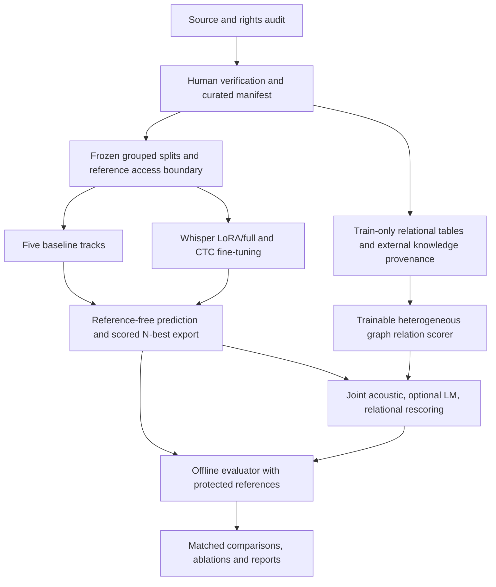

# Intended architecture

Nine of the ten subpackages now hold code (`reporting/` has only an empty `__init__.py`); the
[repository map](../README.md#repository-map) lists what each area contains.

| Future package | Responsibility | Primary ownership boundary |
| --- | --- | --- |
| `data/` | Source/manifest validation, curation, verification, immutable split construction | M1 |
| `baselines/` | Unmodified pretrained adapters and B5 alternative neural baseline | M2 `whisper*`, `qwen3_asr*`; M3 `ctc*`, `bilstm_ctc*` |
| `models/` | Future trainable acoustic model integration | M4 `whisper*`; M5 `ctc*`; M3 `bilstm_ctc*` |
| `training/` | Training routines and checkpoint export, separate from inference | M4 `whisper*`; M5 `ctc*`; M3 `bilstm_ctc*` |
| `decoding/` | Reference-free inputs, N-best export, scoring adapters and orchestration | M4 `whisper*`; M3 `ctc*` export; M5 `rescoring*`; M6 shared interface |
| `rdl/` | Relational-to-graph loading, heterogeneous relation learning, graph scores | M5; CSV schema definitions reviewed by M1 |
| `evaluation/` | ID validation, normalization, WER/CER/terms, timing, comparisons | M6 |
| `reporting/` | Traceable tables, figures, error analysis | M6 |
| `schemas/` | Future machine-enforced versions of the written contracts | M6; domain owners review |
| `utils/` | Only necessary shared provenance/configuration utilities | M6 |

These path patterns reserve future ownership; they do not name existing modules.
M6 owns shared `__init__.py`/packaging and all cross-package interface changes.
Model owners propose named leaf files in a focused PR before creating them.

## Integration boundaries

Training may read train references and validation for selection. Frozen test
references are evaluator-only. Dataset exports separate inference audio metadata
from references; filtering out gold fields inside an already privileged decoder
is insufficient. Graph snapshots exclude held-out reference-derived facts.

Model adapters must return the shared prediction contract. Candidate generation
exports genuine model scores and immutable candidate IDs; rescoring selects among
the same exported candidates. Graph scoring cannot generate replacement gold
text. Evaluation consumes saved predictions and joins references independently.

Unmodified and fine-tuned pairs use the same frozen split and declared decoding
policy. Whisper-small LoRA/full compares with B1; a large-v3 adaptation, if added,
compares with B2. CTC adaptation compares with the exact B4 checkpoint/head and
tokenizer. B3 and B5 remain full baseline tracks even though they are not the
primary adaptation targets. A rule-based graph score may be an ablation but
cannot replace the required trainable heterogeneous model.

## Implementation order

Agree contracts and decisions; curate and freeze a lawful verified dataset;
build the shared evaluator and adapters; evaluate all five baselines; fine-tune
Whisper/CTC; train and validate RDL without test access; freeze selection;
produce final test comparisons, ablations, reproducibility evidence and slides.
Interface design and small offline checks may proceed before dataset release.
The [repository map](../README.md#repository-map) shows where each implemented stage now lives.
