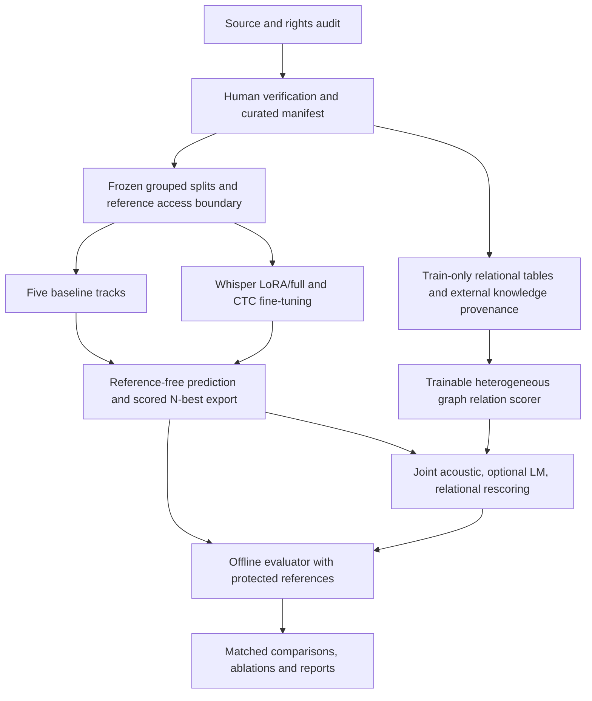

# Intended architecture

Nine of the ten subpackages now hold code (`reporting/` has only an empty `__init__.py`); the
[repository map](../README.md#repository-map) lists what each area contains.

| Package | Contents | Primary ownership |
| --- | --- | --- |
| `data/` | WorldSpeech screening and selection, listening review and verification, release build, relational tables, validation-minutes recovery | M1 |
| `baselines/` | Pretrained adapters and batch runner: Whisper and Qwen3-ASR (B1–B3), Wav2Vec2-CTC (B4), BiLSTM-CTC (B5) | M2 `whisper*`, `qwen`, `runner`; M3 `ctc`, `bilstm_ctc` |
| `models/` | From-scratch B5 BiLSTM-CTC model and feature extractor | M3 `bilstm_ctc` |
| `training/` | Whisper LoRA/full and XLS-R CTC adaptation, a train-only acoustic loop, synthetic optimizer probes | M4 `whisper`, `acoustic`; M5 `ctc` |
| `decoding/` | Shared adapter interface, audio, export, timing, hardware and memory; Whisper and CTC N-best scoring, adapted checkpoints, rescoring, relational inference | M6 shared interface; M4 `whisper`; M5 `ctc`, `adapted`, `rescoring` |
| `rdl/` | Train-only graph snapshots, heterogeneous relation model, training, scoring and N-best rescoring | M5; CSV schema definitions reviewed by M1 |
| `evaluation/` | Normalization, alignment, strict ID join, WER/CER, frozen-lexicon term metrics | M6 |
| `reporting/` | Reserved; only an empty `__init__.py` | M6 |
| `schemas/` | Validators for JSONL, prediction and N-best artifacts and their shared validation report | M6; domain owners review |
| `utils/` | Environment check and private bundle staging | M6 |

M6 owns shared `__init__.py`/packaging and all cross-package interface changes.
Model owners propose named leaf files in a focused PR before creating them.

## Integration boundaries

Training may read train references and validation for selection. Frozen test
references are evaluator-only. Dataset exports separate inference audio metadata
from references; filtering out gold fields inside an already privileged decoder
is insufficient. Graph snapshots exclude held-out reference-derived facts.

Model adapters must return the shared prediction contract. Candidate generation
exports genuine model scores and immutable candidate IDs; rescoring selects among
the same exported candidates. Graph scoring cannot generate replacement gold
text. Evaluation consumes saved predictions and joins references independently.

Unmodified and fine-tuned pairs use the same frozen split and declared decoding
policy. Whisper-small LoRA/full compares with B1; a large-v3 adaptation, if added,
compares with B2. CTC adaptation compares with the exact B4 checkpoint/head and
tokenizer. B3 and B5 remain full baseline tracks even though they are not the
primary adaptation targets. A rule-based graph score may be an ablation but
cannot replace the required trainable heterogeneous model.

## Implementation order

Agree contracts and decisions; curate and freeze a lawful verified dataset;
build the shared evaluator and adapters; evaluate all five baselines; fine-tune
Whisper/CTC; train and validate RDL without test access; freeze selection;
produce final test comparisons, ablations, reproducibility evidence and slides.
Interface design and small offline checks may proceed before dataset release.
The [repository map](../README.md#repository-map) shows where each implemented stage now lives.
